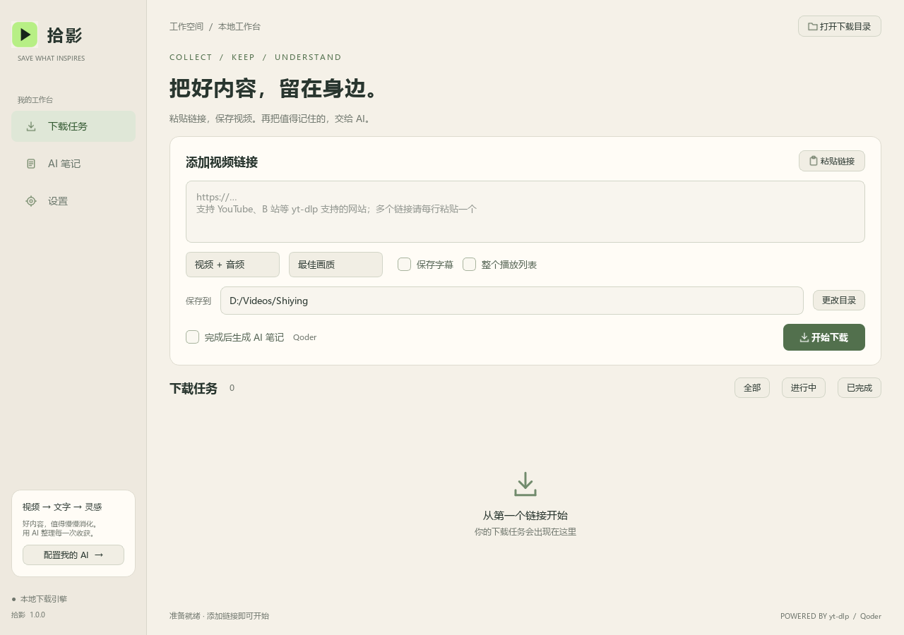

# 拾影 · 视频下载与 AI 笔记

Windows 桌面应用，基于 yt-dlp + PySide6。支持视频/MP3、字幕、播放列表、多链接队列、取消重试，以及 Qoder 或自定义 AI 生成中文笔记。

本项目自己的源码使用 [MIT 许可证](LICENSE)。第三方组件遵循各自的许可证。

## Windows 下载（无需 Python）

前往 **[Releases 下载最新版](https://github.com/Echoqili/shiying/releases/latest)**：

- 推荐下载 `Shiying-1.0.0-windows-x64-setup.exe`，双击安装后从桌面启动。
- 或下载 `Shiying-1.0.0-windows-x64.zip`，全部解压后运行 `Shiying/Shiying.exe`，保留整个文件夹。

支持 Windows 10/11 64 位，包含 FFmpeg。AI 服务需使用自己的账号或 API 配置。详细步骤见 [安装说明](docs/INSTALL.md)。下载页的 `Source code` 是源码，不能直接当作 Windows 安装包运行。



## 运行与使用

安装版可使用桌面快捷方式，免安装版双击 `Shiying.exe`。从源码启动请先完成下方安装步骤。自行构建后，可双击 `dist/Shiying/Shiying.exe` 或 `launch.cmd`。

1. 粘贴完整视频链接，每行一个。
2. 选择画质、视频或 MP3、保存目录；播放列表需主动勾选。
3. 点击“开始下载”。需要 AI 笔记时，勾选“完成后生成 AI 笔记”。
4. 在任务详情中可单独生成/重试 AI；已下载的视频不会因 AI 失败而删除。

默认下载到用户的 `Downloads/拾影`。任务和设置保存在 `%LOCALAPPDATA%/Shiying`，密钥通过 Windows DPAPI 加密，仅相同 Windows 用户能解密。调试时可设置 `SHIYING_DATA_DIR` 指定数据目录。

视频下载优先选择同画质的 H.264/AAC，并输出 MP4。若原始下载使用 AV1、VP9、Opus 或不兼容的封装，会自动生成 H.264（8-bit yuv420p）/AAC 的兼容 MP4，原始下载保留。转码阶段界面会显示提示；高分辨率长视频可能需要额外处理时间。MP3 音频模式不受影响。

## 界面主题

默认采用米白色背景。在“设置 → 界面外观”中可以选择“米白色”或“深色”，点击“保存设置”立即生效，重启后保留选择。

## 配置 Qoder

进入“设置”，选择“Qoder · 使用我的账号额度”。点击“登录 Qoder”，在官方登录终端中完成登录；也可填写 Account → Integrations 中创建的 PAT。CLI 路径和模型可留空，默认使用随 SDK 提供的官方运行时及默认模型。

点击“测试总结连接”检查网络与账号权限。该测试会进行真实推理，消耗少量额度。应用使用官方 Agent SDK 的本机登录/PAT 认证，不读取或复制密码。总结任务禁止工具执行，视频文字稿作为数据发送。

Qoder 额度和地区权限取决于你的账号；应用不保证所有套餐或账号都可使用同一模型。实际账号连接需你登录后验证。本项目的自动化测试未调用真实 Qoder 服务，未使用你的额度。

## 自定义 AI 配置

“总结方式”选择“自定义 · 兼容 OpenAI 接口”，填写：

- API 地址：服务基础地址，如 `https://你的服务商/v1`，或火山方舟 `https://ark.cn-beijing.volces.com/api/v3`。完整 `/chat/completions` 地址也可以。
- API Key：服务商提供的密钥；本地无鉴权服务可留空。
- 模型名称：已开通的实际模型 ID 或接入点 ID。

当前支持 Chat Completions JSON 接口；不将所有厂商的专有接口视为兼容。保存后可测试连接。

## 字幕、转写与笔记

优先读取 yt-dlp 获取的中英文人工/自动字幕。没有字幕时，需在“语音转写”中填写兼容 `/audio/transcriptions` 的 API 地址、密钥及模型（如该服务支持的 `whisper-1`）。转写和总结可以使用不同服务。Qoder 总结额度不包含其他服务的语音识别费用。

音频在本地由 FFmpeg 按 10 分钟分段为单声道 MP3 后上传；文字稿分段总结，再合并观点。视频/音频留在本地，总结服务接收文字；没有字幕时，转写服务接收音频。使用 AI 前可在界面查看说明。

“AI 笔记”页面支持导入本地视频、音频、TXT、SRT 或 VTT。仅导入文字稿时无需转写服务。

生成结果保存在下载目录下 `AI 笔记/<任务 ID 前八位>/`：

- `.md`：摘要、关键观点、时间线、行动建议。
- `.transcript.txt`：文字稿，转写成功后即保存；总结失败时可复用。
- `.srt`：仅在语音服务提供真实片段时间戳时生成，避免编造时间轴。
- `.asr.json`：已完成的转写片段检查点。后续片段失败时，重试会复用已完成的结果，避免重复上传和计费。

AI 服务不返回时间戳时，只标明实际音频分段的起点。笔记页面可切换总结、文字稿及可用的字幕，复制或导出。

## 网络、工具与登录网站

抖音可在“设置 → 下载与网络”点击“登录抖音（Playwright）”。在独立的 Edge/Chrome 窗口中自行扫码登录并完成验证，再回到 App 点击“完成登录，保存”。登录窗口随后关闭；会话使用 Windows DPAPI 加密保存，下次下载抖音链接自动使用，无需手动导出 Cookies。此流程需要本机安装 Edge 或 Chrome，不读取已有浏览器配置文件。会话过期时重新登录即可。登录并不保证能通过网站的所有访问限制。

常规抖音解析失败时，程序会打开已授权会话的浏览器，从正常页面响应中查找与目标视频 ID 一致的详情，再下载其播放地址；不会将页面动画或推荐视频当作目标。遇到网页验证时由用户完成。可直接粘贴含链接的整段抖音分享文案。

YouTube 建议使用正常 Firefox 登录：点击“打开 Firefox 登录”，自行登录并确认能播放视频，再点击“同步 Firefox 的 YouTube 登录状态”。无需插件或手动导出文件。App 只以只读方式查询默认 Firefox 配置中属于 youtube.com 的有效 Cookies，不复制整个数据库，不读取 Google 或其他网站的 Cookies，不读取其他容器的账号；会话加密后仅供 YouTube 下载使用。若 Firefox 正在占用数据库导致读取失败，正常关闭 Firefox 后再点同步。

YouTube 与抖音会话分别加密保存，只在对应站点使用。Google 或网站仍可能要求验证；登录成功不等于下载一定成功，须以具体视频实测为准。

YouTube 的 JavaScript 解析优先使用随 Playwright 打包的 Node 运行时，避免误用系统中不兼容的旧版 Node；无需修改全局 Node 安装。

按安装步骤准备的 FFmpeg/ffprobe，用于合并音视频、MP3 和转写预处理。可在设置中替换工具目录。部分网站（尤其 YouTube）可能需要 Node.js/Deno 运行时、有效 Cookies、代理或额外账号权限；下载能力随网站与 yt-dlp 版本变化。

设置中可填写代理地址及 Netscape 格式 Cookies 文件。Cookies 文件只记录路径，不复制内容；由用户自行导出并保管。仅保存你有权下载、处理的内容。

退出会停止正在执行的工作进程；任务保留并标记为中断。重启后需手动重试，以免自动消耗 AI 额度。取消/强制退出可能留下 `.part` 文件或音频临时目录，可从任务目录检查。原有文件不自动清理。

## 从源码启动与构建

Windows 10/11、Python 3.11+（推荐 3.14），以及用于网页登录的 Microsoft Edge 或 Chrome。先克隆仓库：

```powershell
git clone https://github.com/Echoqili/shiying.git
cd shiying
python -m venv .venv
.\.venv\Scripts\python.exe -m pip install -r requirements-build.txt
.\.venv\Scripts\python.exe scripts/prepare_tools.py --download
.\.venv\Scripts\python.exe main.py
```

如果运行环境已有合适的 PySide6，可使用 `python -m venv --system-site-packages .venv`。

FFmpeg 工具由上述 `--download` 命令下载、校验并放入 `tools/`，二进制不提交到源码仓库。构建使用 yt-dlp 官方 FFmpeg shared 构建，来源和校验和见 `tools/provenance.json`。可从 `https://github.com/yt-dlp/FFmpeg-Builds/releases/tag/latest` 下载对应 zip 及 `checksums.sha256`，分别放到 `.cache/ffmpeg.zip` 与 `.cache/checksums.sha256` 后运行：

```powershell
.\.venv\Scripts\python.exe scripts/prepare_tools.py
```

构建与验证：

```powershell
.\build.ps1
.\.venv\Scripts\python.exe -m unittest discover -s tests -v
$env:SHIYING_DATA_DIR = "$PWD/tests/.tmp/smoke"
.\.venv\Scripts\python.exe main.py --smoke --screenshot "$PWD/docs/preview.png"
```

制作发行包（安装版需要额外安装 Inno Setup 6，并使 `ISCC.exe` 在 PATH 中）：

```powershell
ISCC.exe scripts/windows-installer.iss
.\.venv\Scripts\python.exe scripts/package_release.py
```

生成文件位于 `dist/release/`，包含安装程序、免安装 ZIP 及 `SHA256SUMS.txt`。发行构建应使用独立虚拟环境；`build.ps1 -Python <虚拟环境的 python.exe 路径>` 可指定构建环境。

测试使用本地 HTTP 视频和模拟 AI 服务，验证真实下载、音频分段、协议、密钥保护和故障恢复。Windows 打包程序应另行验证启动和工作进程通信。

测试范围见 [docs/TESTING.md](docs/TESTING.md)。欢迎通过 Issues 报告复现步骤，或提交 Pull Request；请勿上传密钥、Cookies、个人下载内容及账号信息。

第三方声明见 [THIRD_PARTY_NOTICES.md](THIRD_PARTY_NOTICES.md)，构建时会生成 `licenses/`。本应用未关联 yt-dlp、Qoder 或任何视频平台的官方品牌。
